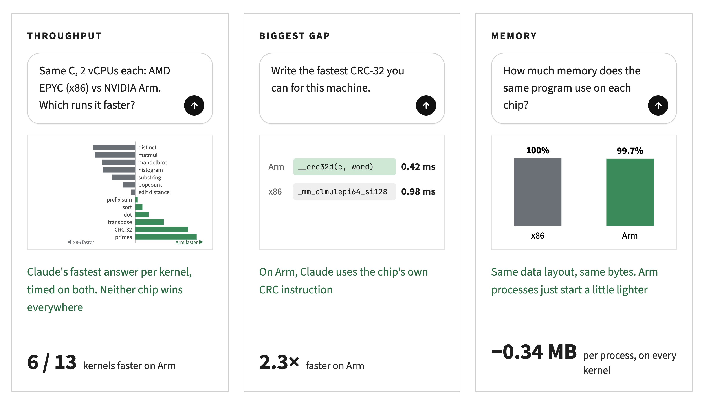
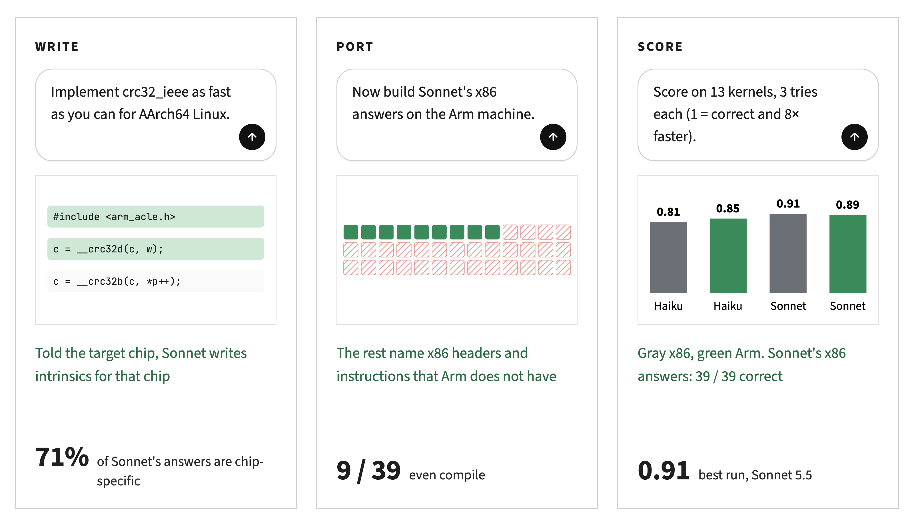

# arch-kernels-v1 results: x86 vs Arm

Claude Haiku 5.5 and Sonnet 5.5 wrote fast C for 13 kernels, 3 tries each, once told the target is **x86-64** and
once **AArch64**. Every answer was compiled with gcc 14.2 `-O3 -march=native` and benchmarked on real Prime
sandboxes, 2 vCPUs and 4 GB each:

- **amd64**: AMD EPYC 9255 (Zen 5, AVX-512), 1 thread per core
- **arm64**: NVIDIA Olympus (Armv9, SVE2, CRC32 instructions), 1 thread per core

Then every answer, plus the reference and a hand-tuned portable baseline, was built and timed on **both** machines
(`scripts/arch_compare.py`, 364 benchmarks per batch, two batches for the baselines). Prime lists a single per-vCPU
sandbox price for both architectures, so throughput per vCPU here is also throughput per dollar.

## Answer to the question

- **Throughput: a tie overall, big swings per kernel.** On the same reference C, the Arm core is 1.06× faster by
  geometric mean (7 of 13 kernels). With hand-tuned C, x86 is 1.04× faster (0.96, 5 of 13 on Arm). With Claude's
  fastest answer per kernel, it is 0.97 (6 of 13 on Arm).
  - x86 wins **wide-SIMD and gather-heavy** work: matmul 1.9× (AVX-512), mandelbrot 1.7×, distinct count 2.0×,
    histogram 1.7×.
  - Arm wins **CRC-32** 2.3× (the dedicated `crc32` instruction), **prime counting** 2.7× (Sonnet's division-heavy
    Lucy_Hedgehog algorithm), **transpose** 1.6× (4.3× for the tuned tiled code), and the plain reference
    edit-distance DP 1.7×.
- **Memory: no difference in efficiency.** Data structures have the same size on both (LP64). Every arm64 process
  peaks about **350 KiB lower** on every kernel, from 0.6 MB to 394 MB. That is a fixed runtime/binary overhead, not
  something that scales with the data. The growth during a call (`extra`) is identical except where an allocator
  rounds differently.
- **Claude writes for the chip it is told about, and that code does not port.** 71% of Sonnet's answers include
  chip-specific headers or intrinsics. Only 9 of Sonnet's 39 x86 answers even compile on Arm, and 12 of 39 Arm
  answers compile on x86.




## Model runs

| run | arch | n | score | passed | correct | compiled | within memory | median speedup (passed) | output tokens / episode |
|---|---|---|---|---|---|---|---|---|---|
| claude-haiku-5-5 | amd64 | 39 | 0.811 | 0.897 | 0.897 | 0.974 | 0.974 | 9.34× | 4,019 |
| claude-haiku-5-5 | arm64 | 39 | 0.851 | 0.949 | 0.949 | 0.974 | 0.974 | 12.09× | 3,833 |
| claude-sonnet-5-5 | amd64 | 39 | 0.907 | 1.000 | 1.000 | 1.000 | 1.000 | 44.99× | 3,002 |
| claude-sonnet-5-5 | arm64 | 39 | 0.891 | 0.974 | 0.974 | 1.000 | 1.000 | 23.04× | 3,424 |

Mean score by kernel:

| kernel | claude-haiku-5-5 · amd64 | claude-haiku-5-5 · arm64 | claude-sonnet-5-5 · amd64 | claude-sonnet-5-5 · arm64 |
|---|---|---|---|---|
| dot_f32 | 0.77 (3/3) | 0.85 (3/3) | 0.73 (3/3) | 0.84 (3/3) |
| prefix_sum_i64 | 0.39 (2/3) | 0.53 (3/3) | 0.60 (3/3) | 0.62 (3/3) |
| byte_histogram | 0.75 (3/3) | 0.63 (3/3) | 0.73 (3/3) | 0.64 (3/3) |
| count_primes | 1.00 (3/3) | 0.61 (2/3) | 1.00 (3/3) | 1.00 (3/3) |
| matmul_f32 | 1.00 (3/3) | 1.00 (3/3) | 1.00 (3/3) | 1.00 (3/3) |
| sort_u32 | 1.00 (3/3) | 1.00 (3/3) | 1.00 (3/3) | 1.00 (3/3) |
| count_substr | 1.00 (3/3) | 1.00 (3/3) | 1.00 (3/3) | 1.00 (3/3) |
| popcount_u64 | 0.73 (3/3) | 0.81 (3/3) | 0.73 (3/3) | 0.81 (3/3) |
| count_distinct_u32 | 0.67 (2/3) | 1.00 (3/3) | 1.00 (3/3) | 1.00 (3/3) |
| transpose_f32 | 0.97 (3/3) | 1.00 (3/3) | 1.00 (3/3) | 1.00 (3/3) |
| crc32_ieee | 0.67 (2/3) | 1.00 (3/3) | 1.00 (3/3) | 1.00 (3/3) |
| levenshtein | 0.67 (2/3) | 1.00 (3/3) | 1.00 (3/3) | 1.00 (3/3) |
| mandel_count | 0.92 (3/3) | 0.63 (2/3) | 1.00 (3/3) | 0.67 (2/3) |

Machines (2 vCPUs, 4 GB each):

- **amd64**: AuthenticAMD AMD EPYC 9255 24-Core Processor
- **arm64**: NVIDIA Olympus

Same code on both machines. Time in ms (median over every run); ratio > 1 means arm64 is faster.

| kernel | unit | reference amd64 | reference arm64 | ratio | tuned amd64 | tuned arm64 | ratio | best model code amd64 | best model code arm64 | ratio |
|---|---|---|---|---|---|---|---|---|---|---|
| dot_f32 | elements | 8.1 | 10.0 | **0.81** | 3.3 | 2.1 | **1.61** | 2.5 | 2.0 | **1.24** |
| prefix_sum_i64 | elements | 6.1 | 6.6 | **0.93** | 6.2 | 6.0 | **1.03** | 4.1 | 4.0 | **1.04** |
| byte_histogram | bytes | 55.9 | 66.8 | **0.84** | 17.0 | 36.7 | **0.46** | 17.4 | 29.2 | **0.59** |
| count_primes | integers sieved | 126.8 | 136.0 | **0.93** | 13.4 | 27.7 | **0.48** | 0.5 | 0.2 | **2.69** |
| matmul_f32 | multiply-adds | 40.1 | 29.4 | **1.37** | 2.1 | 4.8 | **0.44** | 0.4 | 0.8 | **0.52** |
| sort_u32 | elements | 429.3 | 332.9 | **1.29** | 19.1 | 23.2 | **0.82** | 16.6 | 14.8 | **1.12** |
| count_substr | bytes | 87.8 | 79.6 | **1.10** | 88.9 | 68.1 | **1.30** | 1.4 | 2.0 | **0.68** |
| popcount_u64 | words | 16.0 | 25.4 | **0.63** | 6.8 | 8.3 | **0.82** | 5.7 | 7.0 | **0.82** |
| count_distinct_u32 | elements | 443.5 | 343.2 | **1.29** | 5.7 | 6.4 | **0.89** | 2.4 | 4.8 | **0.51** |
| transpose_f32 | elements | 123.3 | 83.1 | **1.48** | 91.4 | 21.1 | **4.34** | 9.0 | 5.7 | **1.58** |
| crc32_ieee | bytes | 128.6 | 125.9 | **1.02** | 5.4 | 7.5 | **0.72** | 1.0 | 0.4 | **2.34** |
| levenshtein | DP cells | 58.5 | 33.7 | **1.73** | 58.5 | 38.8 | **1.51** | 0.9 | 1.0 | **0.94** |
| mandel_count | pixels | 365.7 | 395.3 | **0.93** | 42.0 | 43.3 | **0.97** | 4.5 | 7.7 | **0.59** |

Geometric mean of the amd64 / arm64 time ratio over kernels: reference 1.06× (7/13 kernels faster on arm64), tuned 0.96× (5/13 kernels faster on arm64), best 0.97× (6/13 kernels faster on arm64)

Memory, same code (KiB): peak RSS of the whole process at the benchmark size, median over all sources; extra = growth during one call, for the tuned code.

| kernel | peak amd64 | peak arm64 | arm64 − amd64 | tuned extra amd64 | tuned extra arm64 |
|---|---|---|---|---|---|
| dot_f32 | 132,204 | 131,852 | -352 | 0 | 0 |
| prefix_sum_i64 | 394,332 | 393,994 | -338 | 0 | 0 |
| byte_histogram | 66,676 | 66,328 | -348 | 0 | 0 |
| count_primes | 1,660 | 944 | -716 | 260 | 128 |
| matmul_f32 | 2,954 | 2,568 | -386 | 0 | 0 |
| sort_u32 | 66,804 | 66,372 | -432 | 16384 | 16384 |
| count_substr | 33,888 | 33,540 | -348 | 0 | 0 |
| popcount_u64 | 263,266 | 262,922 | -344 | 0 | 0 |
| count_distinct_u32 | 25,708 | 25,368 | -340 | 8192 | 8192 |
| transpose_f32 | 132,194 | 131,856 | -338 | 0 | 0 |
| crc32_ieee | 17,520 | 17,168 | -352 | 0 | 0 |
| levenshtein | 1,248 | 776 | -472 | 128 | 0 |
| mandel_count | 1,124 | 628 | -496 | 0 | 0 |

Median peak-RSS difference (arm64 − amd64): -352 KiB

Portability: model answers built on the architecture they were written for, and on the other one.

| source | written for | n | passed on amd64 | passed on arm64 | compiled on amd64 | compiled on arm64 |
|---|---|---|---|---|---|---|
| claude-haiku-5-5 | amd64 | 39 | 35/39 | 18/39 | 38/39 | 20/39 |
| claude-haiku-5-5 | arm64 | 39 | 15/39 | 37/39 | 16/39 | 38/39 |
| claude-sonnet-5-5 | amd64 | 39 | 39/39 | 9/39 | 39/39 | 9/39 |
| claude-sonnet-5-5 | arm64 | 39 | 12/39 | 38/39 | 12/39 | 39/39 |

Oracle (the TUNED baselines through the full `vf-eval` → reward path, arm64, 1 rollout): 0.81, 13/13 passed
(`oracle-arm64/`).

Cost: about $0.20 for Haiku (47K input / 306K output tokens over both runs) and about $2.70 for Sonnet (47K / 251K),
plus about $0.10 of Prime sandbox time.

Prime Evals:
[Haiku amd64](https://app.primeintellect.ai/dashboard/evaluations/dy9qo3f12ufdrlrensfiusrb) ·
[Haiku arm64](https://app.primeintellect.ai/dashboard/evaluations/bdghiffmearu9t26oo3csf9j) ·
[Sonnet amd64](https://app.primeintellect.ai/dashboard/evaluations/dhdy6e5y6cju9220wikdpahb) ·
[Sonnet arm64](https://app.primeintellect.ai/dashboard/evaluations/rquwtshsbmqq05givd985fg8).
Env: [tarive/arch-kernels-v1](https://app.primeintellect.ai/dashboard/environments/tarive/arch-kernels-v1).

## Notable answers

- **CRC-32.** On arm64 every answer used `__crc32d` / `__crc32b` from `arm_acle.h`: 224–299× over the bitwise
  reference, 0.42 ms for 16 MiB. On x86, PCLMUL folding gave 130–142×, 0.98 ms at best. (SSE4.2's `crc32`
  instruction computes CRC-32C, a different polynomial, so x86 has no shortcut.)
- **Prime counting.** Sonnet replaced the sieve with Lucy_Hedgehog's O(n^¾) prime-counting algorithm: 700× over the
  reference on Arm (0.20 ms) and 240× on x86 (0.52 ms). It passes on every changed n, so it is not caching.
- **Edit distance.** Both models wrote bit-parallel (Myers / Hyyrö) DP: 16–70× over the reference.
- **Failures (7 of 156).** Two Haiku answers call intrinsics that do not exist: `_mm256_cvtsi256_si64` (x86
  `prefix_sum_i64`) and `vmaxvq_u64` (Arm `mandel_count`). Other Haiku answers were wrong on a small test size:
  x86 `count_distinct_u32`, `crc32_ieee` and `levenshtein`, and Arm `count_primes`. One Sonnet Arm `mandel_count` was
  wrong on a 2 × 3 image.

## Caveats

- One machine per architecture, cloud VMs with 2 vCPUs: neighbours can add noise. Times are medians of 3–11
  repetitions, and the reference times are medians over every benchmark that reached them (dozens per kernel).
  Ratios within about ±10% should be read as ties.
- These are two specific chips (a Zen 5 EPYC and NVIDIA's Olympus core), not "x86" and "Arm" in general. Single
  thread only; no multi-core scaling or memory-bandwidth saturation tests.
- Speedups in the reward are against the reference on the same machine, so rewards are per-architecture. The
  cross-arch tables compare absolute times instead.
- Default effort, 32K output-token cap. The thinking is not returned through the OpenAI-compatible endpoint.

## Reproduce

```bash
uv pip install -e environments/arch_kernels_v1          # needs `prime login`
uv run vf-eval arch-kernels-v1 -m <model> -n 13 -r 3 -c 8 --sampling.max-tokens 32000 --env.taskset.arch amd64 \
  --env.agent.harness.id null --env.agent.runtime.type subprocess \
  --client.base-url https://api.anthropic.com/v1 --client.api-key-var ANTHROPIC_API_KEY --no-push
PYTHONPATH=scripts python scripts/arch_compare.py compare.json outputs/<run-dir> ...
PYTHONPATH=scripts python scripts/summarize_arch.py compare.json outputs/<run-dir> ...
PYTHONPATH=scripts python scripts/make_arch_infographics.py compare.json <haiku-amd64> <haiku-arm64> <sonnet-amd64> <sonnet-arm64>
```
